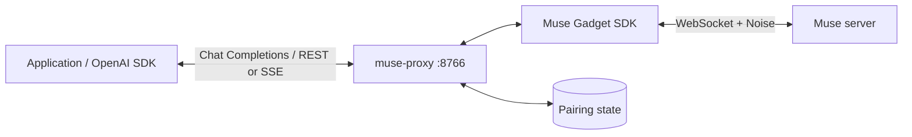

# muse-proxy

A Python proxy that connects external applications to Muse through an OpenAI Chat Completions-compatible HTTP API.
Send text requests and receive progress updates, multiple replies, and cancellation notifications.

The proxy connects directly to Muse servers using paired Muse Gadget credentials.
A smartphone and Bluetooth are unnecessary for everyday conversations.
Complete the initial pairing with the [Muse Gadget SDK](https://github.com/facebookincubator/muse-gadget-sdk),
then transfer the credentials to this proxy.

<a id="features"></a>

## 💎 Features

- **OpenAI-compatible API** — Use Chat Completions over REST or SSE with the official OpenAI Python client.
- **Progress and cancellation** — Distinguish progress, replies, and cancellation through custom metadata, and submit additional requests in the same session.
- **Multiple replies per stream** — Receive multiple Muse replies in one stream under the same completion ID.

[Quick Start](#quick-start) · [How It Works](#how-it-works) · [Usage](#usage) · [Configuration](#configuration) · [Operations](#operations) · [Technical Reference](docs/reference.md)

<a id="quick-start"></a>

## 🚀 Quick Start

Requires Python 3.11 or later, Git, and paired Muse Gadget credentials.
Installation pins the Muse Gadget SDK to a [verified commit](https://github.com/facebookincubator/muse-gadget-sdk/tree/e6fe5174092702ffddae6f90759a38d55a4ebae1/linux).

### 1. Install

Clone the repository, create a virtual environment, and install the package.

```sh
git clone https://github.com/uezo/muse-proxy.git
cd muse-proxy
python3 -m venv .venv
source .venv/bin/activate
python -m pip install -e .
```

### 2. Create configuration and import Muse credentials

```sh
muse-proxy init
```

This creates `proxy.toml` in the current directory with permissions `0600`, without overwriting an existing file.
It sets a random client-facing `api_key` and `default_session_id = "muse-proxy"` to select a dedicated chat.

Transfer the following files from the paired environment to `state_dir` (default: `data/muse`).
Stop the original service before transferring the credentials.

| File | Contents |
| --- | --- |
| `identity.json` | Device identity used during pairing |
| `pairing.json` | Access token, refresh token, and connection details |
| `sdk_token` | The same SDK token used during pairing; optional if supplied through configuration or an environment variable |

On Unix, set directory permissions to `0700` and file permissions to `0600`, and allow the proxy's user to write them.
Relative paths are resolved from the directory containing `proxy.toml`.
See the [credentials reference](docs/reference.md#pairing-state) for an Ubuntu pairing walkthrough, credential transfer commands, and SDK token precedence.

### 3. Start the proxy

```sh
muse-proxy serve --config proxy.toml
```

The default listen address is `http://127.0.0.1:8766`. Press Ctrl+C to stop.
Startup, `GET /health`, and model listing do not connect to Muse; the first conversation request establishes the connection.
The terminal logs incoming requests, HTTP status and duration, conversation outcomes, and sanitized error codes by default.
See [logging and client troubleshooting](#logging) when connecting another application.

### 4. Call the OpenAI-compatible API

In another terminal, configure the client with the `api_key` from `proxy.toml`.
The value below is a placeholder. **The key given to clients is the proxy key, separate from Muse credentials.**

```sh
export MUSE_PROXY_API_KEY="YOUR_PROXY_API_KEY"

curl --silent --show-error --fail-with-body --max-time 200 -N \
  http://127.0.0.1:8766/v1/chat/completions \
  -H "Authorization: Bearer ${MUSE_PROXY_API_KEY}" \
  -H "Content-Type: application/json" \
  -d '{
    "model": "muse",
    "session_id": "my-app-chat",
    "messages": [{"role": "user", "content": "Hello!"}],
    "stream": true
  }'
```

| Client setting | Default |
| --- | --- |
| Base URL | `http://127.0.0.1:8766/v1` |
| API key | `api_key` from `proxy.toml` |
| Model | `muse` |

With `stream: false`, the proxy waits for task completion and combines the replies into one JSON response.
SSE returns progress updates and completed reply messages as they arrive.
See [compatibility and extensions](docs/reference.md#openai-compatible-protocol) for details.

<a id="how-it-works"></a>

## ⚙️ How It Works



1. An application sends a Chat Completions request, and the proxy generates a completion ID.
2. The proxy sends the message to Muse and receives a Muse message ID as acknowledgement.
3. A separate subscription receives structured progress, replies, and task state from Muse.
4. The proxy assigns events to requests, determines when they finish, and returns REST or SSE responses.

Muse acknowledges outgoing messages separately from delivering generated replies.
Two requests sent to Muse may produce one combined reply or several reply messages.
Requests in the same session share one subscription, allowing additional messages while a reply is pending.
Connections for different sessions are processed serially within the account.

### Message types

`muse_proxy.kind` is a custom attribute added by this proxy.

| Kind | Source or trigger | Content returned to the client | Request termination |
| --- | --- | --- | --- |
| `progress` | Muse's `agent.status` | Published progress text and `activity_code`, when available | Keeps the request open |
| `reply` | A Muse reply message is complete | Reply text in the usual `delta.content` | A single completed message does not end the request |
| `cancel` | The proxy supersedes an older request, or Muse reports cancellation | Empty content and `superseded_by` when the replacement is known | Ends that request |

The proxy uses Muse's `running` and `completed` states internally to determine completion.
The API does not add a custom `status` field or a status lookup endpoint.
Replies are sent when each message is complete, rather than token by token.

<a id="usage"></a>

## 📖 Usage

### Python: stream progress and replies

Install the official Python client in the calling application's environment.

```sh
python -m pip install 'openai>=1.100,<4'
```

```python
import os

from openai import OpenAI

reply_parts = []

with OpenAI(
    base_url="http://127.0.0.1:8766/v1",
    api_key=os.environ["MUSE_PROXY_API_KEY"],
    timeout=200.0,
    max_retries=0,
) as client:
    with client.chat.completions.create(
        model="muse",
        messages=[
            {"role": "user", "content": "Research this and keep me updated on your progress."}
        ],
        extra_body={"session_id": "my-app-chat"},
        stream=True,
    ) as stream:
        for chunk in stream:
            metadata = chunk.model_dump().get("muse_proxy") or {}
            kind = metadata.get("kind")

            if kind == "cancel":
                reply_parts.clear()
                print("cancel>", metadata.get("superseded_by"))
            elif chunk.choices:
                text = chunk.choices[0].delta.content or ""
                if kind == "progress":
                    print("progress>", text.rstrip())
                elif kind == "reply":
                    reply_parts.append(text)
                    print("muse>", text)
```

When receiving `cancel`, the client handles discarding accumulated reply text and any partial display for that request.
The example clears the accumulated list but leaves previously printed output visible. A UI should also remove that display.
The SDK handles cancellation as normal stream exhaustion; it does not raise a cancellation-specific exception or retry automatically.
The SDK consumes `[DONE]` without yielding it, so inspect each chunk's `kind`.

With the higher-level `client.chat.completions.stream()`, inspect `event.chunk` when `event.type == "chunk"`.
`get_final_completion()` alone may not preserve cancellation metadata.
See [receiving events with the SDK](docs/reference.md#python-sdk) for details.

### Python: wait for the complete answer

Inside the same client's `with` block, set `stream=False`.

```python
result = client.chat.completions.create(
    model="muse",
    messages=[{"role": "user", "content": "Hello!"}],
    extra_body={"session_id": "my-app-chat"},
    stream=False,
)
metadata = result.model_dump().get("muse_proxy") or {}
if metadata.get("kind") == "cancel":
    print("cancel>", metadata.get("superseded_by"))
else:
    print(result.choices[0].message.content)
```

Normal REST responses omit progress and join multiple replies with blank lines.
Cancellation returns HTTP 200, empty assistant content, and `muse_proxy.kind="cancel"`.

### Sessions and overlapping requests

Use the same `session_id` to continue the same chat. Omitting it uses `default_session_id`.
Labels are deterministically mapped to UUIDs using the device identity: the same device identity and label always produce the same UUID.
If you supply a UUID, the proxy uses that UUID directly.
`session_id` must contain 1–64 ASCII letters, digits, or hyphens.

**When a reply has no request association ID, the proxy assigns it to the latest acknowledged pending request
in the same session and sends `cancel` to all other acknowledged pending requests.**
A new request alone does not trigger cancellation. Ordering follows Muse's acknowledgements.
Replies with a known parent ID are returned to the corresponding request.

For example, while A, "Find ramen restaurants in Sapporo," is running, send B,
"Also find ramen restaurants in Hakata. Answer with the Sapporo results first."
If the association IDs are empty, the sequence can be:

```text
A: progress → cancel(superseded_by=B's completion ID) → stop → [DONE]
B: progress → reply(Sapporo) → progress → reply(Hakata) → stop → [DONE]
```

B receives ordinary reply content under one completion ID.
Each `reply` keeps the request open until the overall task is complete and all messages being received are complete.
This is the proxy's routing policy; it does not indicate that Muse decided one request semantically supersedes another.
Use different `session_id` values when each request needs an independent answer.

### Extensions to the OpenAI API

**The following extensions belong to muse-proxy. They are not standard OpenAI API cancellation features or status values.**

| Extension | Location | Meaning |
| --- | --- | --- |
| `session_id` | Top level of the request JSON | Selects a Muse chat; pass through `extra_body` in the SDK |
| `muse_proxy.kind` | SSE content chunks and REST cancellation responses | `progress` / `reply` / `cancel` |
| `muse_proxy.request_id` | Same as above | Proxy-generated completion `id`, also used for `x-request-id` |
| `muse_proxy.message_id` | Same as above | Muse message ID, or a proxy-generated ID when unavailable |
| `muse_proxy.sequence` | Same as above | Counts progress, reply, and cancel events within the request, starting at 1 |
| `muse_proxy.activity_code` | SSE progress, only when available | Muse progress code; separate from OpenAI status values |
| `muse_proxy.superseded_by` | Cancellation responses | Replacement completion ID, or `null` when unknown |

Normal REST replies omit `muse_proxy`.
SSE role, normal termination, usage, and keepalive frames also omit it.

| Outcome | Termination sequence |
| --- | --- |
| Normal completion | Overall task and messages complete → `finish_reason="stop"` → `[DONE]` |
| Cancellation | Cancel notification with empty content → `finish_reason="stop"` → `[DONE]` |
| Error after SSE starts | `{"error": {...}}` → `[DONE]`; no normal `stop` chunk |

**Normal completion and cancellation both use `finish_reason="stop"`. Do not use `[DONE]` alone to distinguish success, cancellation, and errors.**
The proxy also converts Muse's native `cancelled` / `canceled` states to cancellation notifications.
The conditions that trigger those states are unverified, and `superseded_by` is `null` for these notifications.
See [field definitions, JSON/SSE examples, and error behavior](docs/reference.md#extensions).

<a id="configuration"></a>

## 🔧 Configuration

### Configuration file

The CLI reads `proxy.toml` from the current directory. Use `--config` to select another file.

```sh
muse-proxy serve --config /path/to/proxy.toml
```

| Setting | Default | Purpose |
| --- | --- | --- |
| `api_key` | Generated by `init` | Client-facing Bearer key, independent of Muse credentials |
| `state_dir` | `data/muse` | Location of paired credentials, relative to the configuration file |
| `host` / `port` | `127.0.0.1` / `8766` | HTTP listen address |
| `model` | `muse` | Model alias accepted by the API |
| `default_session_id` | Set to `muse-proxy` by `init` | Chat used when `session_id` is omitted |
| `sdk_token` | Unset | The same Muse SDK token used during pairing |
| `vm_id` | Unset | Target VM ID or VM name |
| `request_timeout_seconds` | `180.0` | Overall response timeout per request; progress does not extend it |
| `connect_timeout_seconds` | `30.0` | Connection timeout |
| `max_request_bytes` | `307200` | Maximum HTTP request body size in bytes |
| `max_message_chars` | `16000` | Maximum character count for the last user message |

Existing configurations without `default_session_id` use the main chat when no chat is specified.
The API's `session_id` takes precedence over configuration; both omission and `null` use the configured default.
The label does not set the chat's display name in the Muse app.

`MUSE_PROXY_API_KEY` overrides the proxy key, and `MUSEGADGET_SDK_TOKEN` overrides the Muse SDK token.
`.env` files are not loaded automatically. Restart the proxy after configuration changes.
See [Configuration](docs/reference.md#configuration) for all settings and credential precedence.

### Compatibility scope

| Interface | Endpoint | Behavior |
| --- | --- | --- |
| Chat Completions REST | `POST /v1/chat/completions` | Reply JSON without progress, or cancellation |
| Chat Completions SSE | Same endpoint with `stream: true` | Progress, multiple ordinary replies, and cancellation |
| Models | `GET /v1/models`, `GET /v1/models/{model}` | Configured model information |
| Health | `GET /health` | Proxy process liveness |

Routes under `/v1` require `Authorization: Bearer <api_key>`.
**Only the last user message in `messages` is sent to Muse.**
Muse manages conversation history and persona; earlier history and system/developer instructions are not forwarded.
The API supports text conversations with `n=1`. Responses API, WebSocket, push reception, and image/audio input are unsupported.

Generation parameters accepted for compatibility are not forwarded to Muse.
With `stream_options.include_usage: true`, the last chunk contains `choices: []` and `usage: null`, without token counts.
See the [accepted, ignored, and rejected fields](docs/reference.md#openai-compatible-protocol).

<a id="operations"></a>

## 🛠️ Operations

<a id="logging"></a>

### Logging and client troubleshooting

`serve` logs to stderr at `info` level by default. Each HTTP request has an internal `http_id` for correlating its arrival and completion,
including rejected requests. Accepted chat requests also log the generated completion `request_id`.
Logs show the HTTP method, recognized route, response status, duration, and completion or cancellation outcome.
Failures include a sanitized error code and, when available, the parameter name.
An unknown route is sanitized instead of logging its raw path.

Enable additional proxy diagnostics with:

```sh
muse-proxy serve --config proxy.toml --log-level debug
```

Supported levels are `debug`, `info`, `warning`, `error`, and `critical`.
Debug mode enables proxy diagnostics while keeping server logs at `info` to avoid WebSocket handshake/header dumps.
Other levels apply to both proxy and server logs. SDK and network-library debug logging is not enabled.
Proxy request logs omit message bodies, API keys, authentication headers, query strings, and session IDs.
**An SSE request can log HTTP 200 and still fail:** inspect the error code and the stream's error frame, not just the HTTP status.

For a third-party client, check these settings and log results:

| Log or symptom | What to check |
| --- | --- |
| No incoming-request log at `info` level | The request has not reached this process; check the client URL, listen address, port, and reverse proxy |
| 404 for an unknown route | Use base URL `http://127.0.0.1:8766/v1` and Chat Completions; the Responses API is unsupported |
| 401 / `invalid_api_key` | Use the proxy's `api_key`, rather than a Muse token |
| 404 / `model_not_found` | Set the client's model to the configured alias, `muse` by default |
| 400 / `invalid_request_error` | Check the logged parameter and the [supported request fields](docs/reference.md#openai-compatible-protocol) |
| 403 / `origin_rejected`, or `OPTIONS` returns 405 | A browser client is making a cross-origin request; the proxy does not enable CORS or handle preflight requests. Route through the application's backend or a suitable same-origin deployment |

These diagnostics do not change the API's authentication, origin checks, or supported endpoints.

### Runtime and credentials

- **Startup and shutdown** — The CLI runs in the foreground with one worker. Operate one process with one worker.
- **Request storage** — Pending requests and subscriptions are held in memory. Restart recovery and result lookup by request ID are unavailable.
- **Credential refresh** — Before connecting, credentials are refreshed if they were saved at least three hours ago. A 401 during VM lookup also triggers refresh. Updated credentials are saved to `pairing.json`.
- **Backups** — Preserve `proxy.toml` and the files in `state_dir`. Avoid using the same Muse credentials concurrently in multiple processes.
- **Disconnects and retries** — Disconnecting ends that request's wait. The subscription remains active if another request is waiting in the same session. Muse may continue executing accepted requests, so check before retrying automatically.
- **External access** — The default address is localhost. For external access, configure an HTTPS reverse proxy, the listen address, and the API key.

| Symptom | What to check |
| --- | --- |
| `/health` succeeds but conversations fail | Health does not check Muse connectivity; verify credentials and the target connection |
| Credential files are missing | Normal REST returns 503; an already-started SSE response stays HTTP 200 and delivers an error followed by `[DONE]` |
| An older request ends with an empty reply | Check `muse_proxy.kind="cancel"` and `superseded_by` |
| `muse_timeout` / `muse_reply_timeout` | Check execution in Muse and adjust server and client timeouts if needed |
| Previously delivered text is revised, causing `muse_protocol_error` | Delivered SSE content cannot be rolled back; replacement text for the same message ID ends the request with an error |

See [errors and termination](docs/reference.md#errors) and [credential migration and refresh](docs/reference.md#pairing-state) for details.

<a id="development"></a>

## 🧪 Development

```sh
python -m pip install -e '.[dev]'
pytest -q
ruff check .
ruff format --check .
python -m build
```

Tests use temporary files and simulated connections; they require no real account, Bluetooth, or external network access.
They cover the official OpenAI Python SDK, encrypted SDK communication, request routing, progress and cancellation,
completion after multiple replies, disconnects, timeouts, and credential refresh.

Live service checks have also verified credentials transferred from Linux to Mac, dedicated chat creation,
cancellation of an older request during consecutive Sapporo/Hakata requests,
and two replies followed by a final `[DONE]` on the latest request.

See the [Technical Reference](docs/reference.md) for the full specification.
